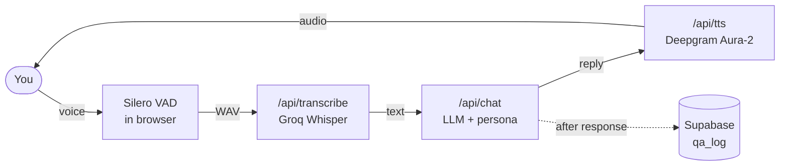

# Ask Rounak

A voice bot that answers interview questions the way I would. Tap the orb, ask a question out loud, and it answers in my voice persona: my background, projects, working style and how I think.

**Live:** [ask.rounak.co](https://ask.rounak.co)

## Features

- **Hands-free voice mode.** Voice activity detection runs in the browser, so you just talk. Interrupt it mid-answer and it stops and listens.
- **Grounded answers.** It answers only from my own notes, says so when something isn't covered, and politely deflects personal topics.
- **Natural voice.** Replies are spoken by Deepgram Aura-2 with custom pronunciations for names and places, falling back to the browser's voice if needed.
- **Text and dictation too.** A side panel holds the transcript, a text box, and tap-to-talk dictation that fills the box for review before sending.
- **Resilient by design.** Two Groq models and Gemini form a rate-limit-aware fallback chain, and every external call has a timeout and a fallback path.
- **Transcript download** and a disclosed Q&A log (no IP addresses stored).

## How it works



1. The browser detects when you start and stop speaking, and sends the clip to the server.
2. Groq Whisper transcribes it. Low-confidence transcripts (coughs, background noise) are dropped.
3. The question and the last 10 messages go to the LLM with the persona as the system prompt.
4. The reply is streamed back as speech, and the question and answer are logged after the response is sent.

See [docs/ARCHITECTURE.md](docs/ARCHITECTURE.md) for the full system design, request flows and decisions.

## Tech stack

| Layer | Choice |
|---|---|
| App | Next.js 15 (App Router), React 19, TypeScript, Tailwind CSS v4 |
| Speech to text | Groq Whisper `whisper-large-v3-turbo` |
| LLM | Groq `gpt-oss-120b` → Groq `gpt-oss-20b` → Gemini Flash, via OpenAI-compatible APIs |
| Text to speech | Deepgram Aura-2, browser `speechSynthesis` as fallback |
| Voice detection | Silero VAD via `@ricky0123/vad-web` (ONNX in WebAssembly) |
| Logging | Supabase Postgres, written server-side over the REST API |
| Hosting | Vercel |

No AI SDKs: every provider is called with plain `fetch`.

## Run locally

Requirements: Node.js 20+, and API keys for Groq, Gemini and Deepgram. Supabase is optional (logging is skipped without it).

```bash
git clone https://github.com/Rounak7721/ask-rounak.git
cd ask-rounak
npm install
cp .env.example .env.local   # then fill in your keys
make dev                     # http://localhost:3000
```

Other targets: `make check` (lint, type check and production build), `make lint`, `make typecheck`, `make build`.

### Environment variables

| Variable | Purpose |
|---|---|
| `LLM_PROVIDER` | `groq` (default) or `gemini`: which provider is tried first |
| `GROQ_API_KEY` | Groq key, used for chat and transcription |
| `GROQ_CHAT_MODEL` | Primary chat model, e.g. `openai/gpt-oss-120b` |
| `GROQ_CHAT_MODEL_2` | Second chat model with its own rate limit, e.g. `openai/gpt-oss-20b` |
| `GROQ_STT_MODEL` | `whisper-large-v3-turbo` |
| `GEMINI_API_KEY` / `GEMINI_MODEL` | Gemini fallback |
| `DEEPGRAM_API_KEY` / `DEEPGRAM_TTS_MODEL` | Voice, e.g. `aura-2-orpheus-en` |
| `SUPABASE_URL` / `SUPABASE_SERVICE_ROLE_KEY` | Optional Q&A logging |

All keys are server-only. Every other setting (endpoints, model parameters, timeouts, limits, VAD thresholds) lives in [`lib/config.ts`](lib/config.ts).

### Logging table (optional)

```sql
create table public.qa_log (
  id          bigint generated always as identity primary key,
  created_at  timestamptz not null default now(),
  session_id  text not null,
  input_mode  text check (input_mode in ('voice', 'live', 'text')),
  provider    text,
  question    text not null,
  answer      text not null
);
alter table public.qa_log enable row level security; -- no policies: only the server key can write
```

## Project structure

```
app/
  page.tsx              main screen: voice mode, orb, controls
  api/chat/             LLM route (history clipping, rate limit, logging)
  api/transcribe/       speech to text route
  api/tts/              text to speech route (streams audio)
components/             Orb, Panel, Composer, Waveform, buttons, icons
hooks/                  useLive (VAD), useRecorder (dictation), useSpeech (playback)
lib/
  config.ts             all endpoints, models, parameters and limits
  persona.ts            system prompt: rules and my notes
  llm/                  provider targets and rate-limit-aware fallback
  stt.ts, tts.ts        Whisper and Deepgram clients
  pronunciations.ts     IPA and respellings for the voice
docs/ARCHITECTURE.md    system design
```

## Privacy

Questions and answers are logged to improve the bot, and the page footer says so. IP addresses are never stored; they're used only in memory for rate limiting. API keys never reach the browser.

## Known limitations

- Tested mainly in Chrome on desktop and mobile. iPhone Safari is untested and may fall back to the browser voice.
- Free-tier LLM limits mean heavy traffic falls back to Gemini, which is slower.
- Rate limiting and rate-limit tracking are in memory, per server instance.

## License

[MIT](LICENSE)
