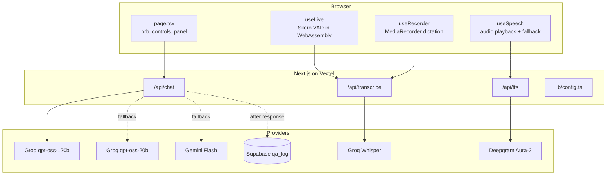
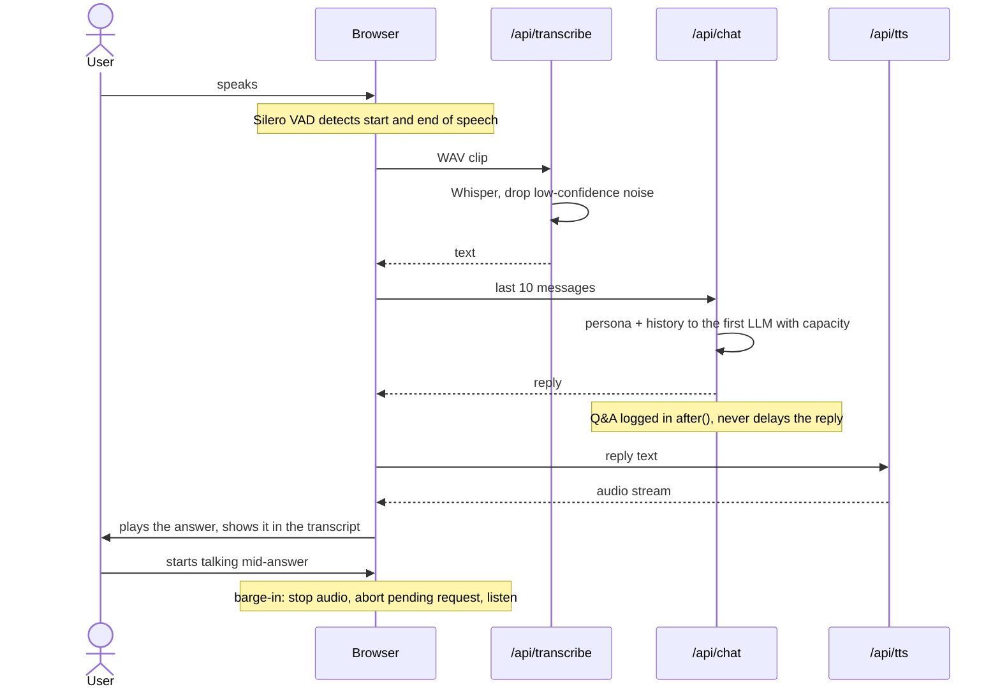
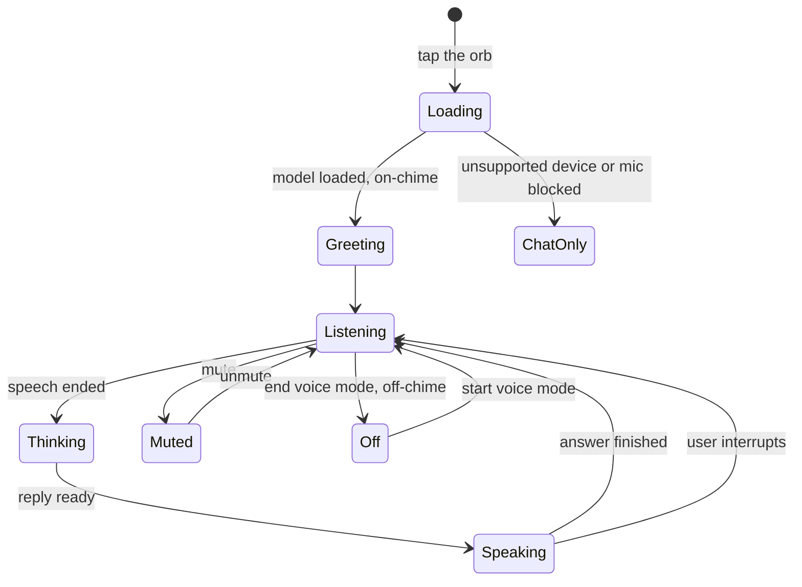
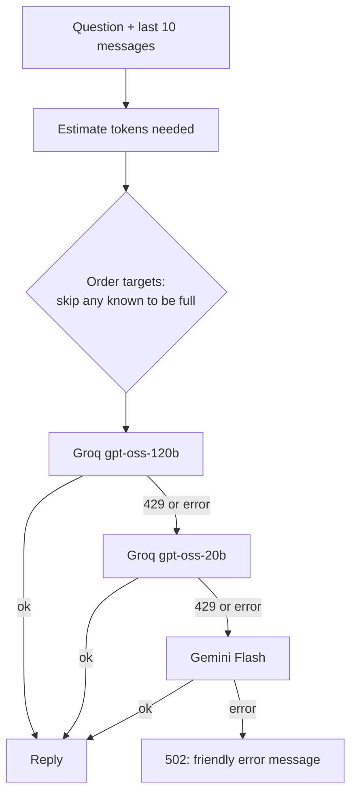

# Architecture

How Ask Rounak turns a spoken question into a spoken answer, and why it's built the way it is.

## 1. System overview

The app is a single Next.js project. The browser owns everything that has to be real-time (voice detection, recording, playback, the orb animation). Three small server routes own everything that needs a secret key. No API key ever reaches the browser.

| Route | Input | Output | Provider |
|---|---|---|---|
| `POST /api/transcribe` | audio blob (≤ 4 MB) | `{ text }` | Groq Whisper |
| `POST /api/chat` | last 10 messages, session id, input mode | `{ reply, provider }` | Groq → Groq → Gemini |
| `GET /api/tts?text=` | reply text (≤ 2000 chars) | streamed `audio/mpeg` | Deepgram |

All tunable values (endpoints, model parameters, timeouts, limits, VAD thresholds) live in [`lib/config.ts`](../lib/config.ts). Model IDs and keys come from environment variables.

## 2. One voice turn

**Barge-in.** The VAD's speech-start event calls `interrupt()`, which stops playback and aborts any in-flight chat request through an `AbortController`. The new question then goes through the same turn.

**Dictation** uses the same transcription route, but the text lands in the text box so the user can review it before pressing send.

## 3. Voice mode states

- The greeting audio is fetched while the VAD model loads, so it plays the moment loading finishes. The screen only invites the user to speak once the greeting has started.
- Muting or ending voice mode pauses the VAD and releases the microphone, but keeps the model loaded, so turning it back on is instant.
- If the device lacks microphone access, Web Audio or WebAssembly, the user gets a message and a button straight into the text chat.

## 4. LLM routing and fallback

- Groq's free tier allows 8,000 tokens per minute **per model**, and one request is about 4,300 tokens (mostly the persona). A second Groq model gives a second bucket, so a normal interview pace stays entirely on Groq at about one second per reply.
- After each call, the remaining-token and retry-after headers are remembered per model. The next request skips a model that can't take it instead of waiting for a 429. This state is in memory per server instance; the 429 fallback remains the safety net.
- Gemini is the last resort: reliable, but noticeably slower.

**Context and cost control**

| Guard | Value | Why |
|---|---|---|
| History sent | last 10 messages | Enough for follow-ups, bounded cost |
| Message clip | 2000 characters | One long message can't break later requests |
| Output cap | 1200 tokens | Safety net against runaway replies (includes reasoning tokens) |
| Request timeout | 15 s | A stuck provider falls through to the next one |
| Rate limit | 30 chat / 30 transcribe / 60 TTS per IP per 10 min | Abuse protection |

## 5. The persona

The whole persona lives in the system prompt ([`lib/persona.ts`](../lib/persona.ts)), in two parts:

- **Rules:** spoken style (2 to 3 short sentences, no lists or symbols), answer only what was asked, never invent facts, boundaries for personal topics, honesty about being an AI, resistance to prompt injection.
- **Notes:** my own answers to common interview questions, short stories (each used at most once per conversation), and facts about projects and skills.

There is no retrieval step: the notes fit comfortably in the prompt, so every answer sees everything.

## 6. Listening: filtering noise

Whisper invents whole sentences from noise. A cough can come back as "I'm not sure what I'm doing." Two layers stop that:

1. **Stricter VAD.** Speech probability above 0.5 (library default 0.3) for at least 600 ms (default 400 ms). This also stops a cough from cutting off the bot mid-answer.
2. **Confidence filter.** Whisper's duration-weighted average log-probability is checked on the server. Measured: noise ≈ -1.4, real speech -0.2 to -0.5, even short or noisy questions. Anything below -1.0 is dropped silently.

A short Whisper prompt with project and place names improves spelling of proper nouns.

## 7. Speaking: voice output

- Deepgram Aura-2 is called server-side and its audio is **streamed** straight through to an `<audio>` element. The 15 s timeout covers only the wait for Deepgram to respond, not the stream itself.
- [`lib/pronunciations.ts`](../lib/pronunciations.ts) fixes names in the voice only: IPA overrides for words like Rounak, Kolhapur and ClauseGuard, and plain respellings for others. One combined regex replaces each word exactly once; the on-screen transcript keeps the real spelling.
- If Deepgram fails or the browser blocks playback, the browser's built-in `speechSynthesis` reads the reply instead. Voice output can also be turned off for text-only replies.

## 8. Security and privacy

- API keys are read only in server files; `lib/config.ts` holds no secrets because browser code imports it too.
- Security headers: `X-Content-Type-Options`, `X-Frame-Options: DENY`, a strict `Referrer-Policy`, and a `Permissions-Policy` that allows only the microphone.
- Logging happens in `after()`, once the response has been sent, and fails silently. It stores the session id, input mode, provider, question and answer; never IP addresses. The table has row-level security with no policies, so only the server key can write to it.
- The footer discloses that questions and answers are saved.

## 9. Key decisions

| Decision | Why |
|---|---|
| Full persona in the prompt, no RAG | The notes fit in about 4k tokens; retrieval would add latency and a way to miss facts |
| Two Groq models + Gemini fallback | Free-tier limits are per model; Groq is fast, Gemini is the reliable backstop |
| Deepgram Aura-2 over browser voices | Browser voices vary by device and sound robotic; Deepgram is consistent, with pronunciation control |
| VAD in the browser | Hands-free conversation with no audio streamed until speech is detected |
| Plain `fetch`, no AI SDKs | All providers speak OpenAI-compatible JSON; fewer dependencies |
| One config file | Endpoints, models and limits change without touching code |
| No Content-Security-Policy yet | The VAD loads WebAssembly and models from a CDN; a strict policy risked breaking voice mode |

## 10. Future plans

1. **Streaming replies.** Stream LLM tokens and start speaking sentence by sentence, so the first words play in well under a second.
2. **Retrieval over project docs.** If the knowledge grows beyond interview notes (full READMEs, write-ups), add RAG so the bot can answer deeper technical questions without bloating every prompt.
3. **Automated persona evals.** A fixed set of questions and traps run on every persona change, checking reply length, boundaries and factual grounding.
